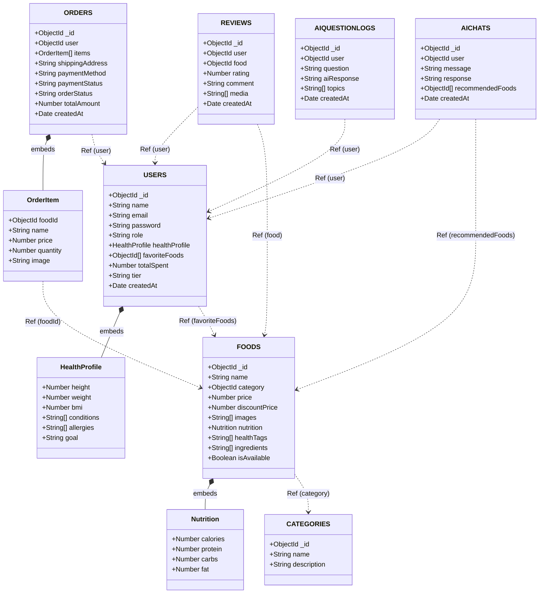

# TÀI LIỆU THIẾT KẾ CƠ SỞ DỮ LIỆU & HƯỚNG DẪN BÁO CÁO DỰ ÁN FOODCARE
*Hệ thống đặt món ăn dinh dưỡng & Trợ lý ảo tư vấn sức khỏe qua AI*

---

## MỤC LỤC
1. [Giới thiệu Cơ sở dữ liệu & Công nghệ](#1-giới-thiệu-cơ-sở-dữ-liệu--công-nghệ)
2. [Sơ đồ Mô hình Dữ liệu (Document Data Model Diagram)](#2-sơ-đồ-mô-hình-dữ-liệu-document-data-model-diagram)
3. [Đặc tả Chi tiết các Collection (Data Dictionary)](#3-đặc-tả-chi-tiết-các-collection-data-dictionary)
4. [So sánh MongoDB (NoSQL) với MySQL (RDBMS) trong Đồ án](#4-so-sánh-mongodb-nosql-với-mysql-rdbms-trong-đồ-án)
5. [Bộ câu hỏi & Hướng dẫn trả lời trước Hội đồng phản biện](#5-bộ-câu-hỏi--hướng-dẫn-trả-lời-trước-hội-đồng-phản-biện)

---

## 1. GIỚI THIỆU CƠ SỞ DỮ LIỆU & CÔNG NGHỆ

### 1.1. Mục đích thiết kế cơ sở dữ liệu
Thiết kế cơ sở dữ liệu cho hệ thống FoodCare nhằm đảm bảo khả năng lưu trữ, xử lý thông tin cá nhân hóa (hồ sơ bệnh lý, dị ứng, mục tiêu dinh dưỡng), danh mục món ăn với đa dạng chỉ số vi chất (calo, protein, carb, fat, fiber) và lịch sử tương tác AI theo thời gian thực với độ trễ thấp, đáp ứng các tiêu chuẩn hiệu năng cao và khả năng mở rộng linh hoạt.

### 1.2. Lý do lựa chọn MongoDB (NoSQL) thay vì MySQL (RDBMS)
- **Cấu trúc dữ liệu phi cấu trúc & Bán cấu trúc:** Thực đơn món ăn và hồ sơ sức khỏe người dùng thường xuyên thay đổi (mỗi người dùng có thể có nhiều hoặc không có bệnh lý nền/dị ứng; món ăn có thể có nhiều thẻ sức khỏe, nhiều chỉ số dinh dưỡng khác nhau). MongoDB cho phép lưu trữ tài liệu JSON (BSON) linh hoạt mà không cần cố định số cột.
- **Tối ưu hóa hiệu năng bằng cơ chế Nhúng (Embedding):** Giảm thiểu chi phí truy vấn đa bảng (`JOIN`) phức tạp của RDBMS, cho phép lấy toàn bộ đơn hàng kèm chi tiết món ăn hoặc thông tin dinh dưỡng của món ăn chỉ trong một lần truy vấn duy nhất (`Single-read`).
- **Tích hợp tự nhiên với Node.js / Express (MERN Stack):** Dữ liệu trao đổi qua lại giữa Frontend (React), Backend (Express API) và Database (MongoDB) đồng nhất dưới định dạng JSON/JavaScript Object, tối ưu hóa tốc độ phát triển.

---

## 2. SƠ ĐỒ MÔ HÌNH DỮ LIỆU (DOCUMENT DATA MODEL DIAGRAM)

Trong MongoDB, sơ đồ mô hình dữ liệu thay thế hoàn toàn cho cả 2 sơ đồ truyền thống của MySQL (Sơ đồ quan hệ thực thể ERD và Sơ đồ quan hệ bảng vật lý). Sơ đồ này biểu diễn rõ:
- **Quan hệ nhúng (Embedding `◆`):** Dữ liệu con được lưu trữ trực tiếp bên trong Document cha (Composition).
- **Quan hệ tham chiếu (Referencing `--->`):** Dữ liệu được liên kết thông qua trường `ObjectId` (Mongoose Ref).

---

## 3. ĐẶC TẢ CHI TIẾT CÁC COLLECTION (DATA DICTIONARY)

### 3.1. Collection `users` (Người dùng)
* **Mô tả:** Lưu trữ thông tin tài khoản, phân quyền, xếp hạng thành viên và hồ sơ thể trạng sức khỏe cá nhân (nhúng trực tiếp).

| STT | Tên trường (Field) | Kiểu dữ liệu | Ràng buộc / Mặc định | Mô tả ý nghĩa |
| :---: | :--- | :--- | :--- | :--- |
| 1 | `_id` | ObjectId | Primary Key (Auto) | Mã định danh người dùng do MongoDB tự tạo. |
| 2 | `name` | String | Required, Trim | Họ và tên người dùng. |
| 3 | `email` | String | Required, Unique | Email đăng nhập hệ thống. |
| 4 | `password` | String | Required | Mật khẩu tài khoản (mã hóa bcrypt). |
| 5 | `role` | String | Enum: `['user', 'admin']` Default: `'user'` | Quyền hạn tài khoản. |
| 6 | `avatar` | String | Optional | Đường dẫn URL ảnh đại diện. |
| 7 | `healthProfile` | Object (Embedded) | Object nhúng | Hồ sơ thể trạng và sức khỏe cá nhân. |
| 8 | `healthProfile.height` | Number | Min: 0 | Chiều cao của người dùng (cm). |
| 9 | `healthProfile.weight` | Number | Min: 0 | Cân nặng của người dùng (kg). |
| 10 | `healthProfile.bmi` | Number | Min: 0 | Chỉ số khối cơ thể (BMI) tự động tính. |
| 11 | `healthProfile.conditions` | Array [String] | Default: `[]` | Danh sách bệnh lý nền (tiểu đường, tim mạch, gout...). |
| 12 | `healthProfile.allergies` | Array [String] | Default: `[]` | Danh sách dị ứng thực phẩm (hải sản, đậu phộng...). |
| 13 | `healthProfile.goal` | String | Enum: `['maintain', 'weight_loss', 'muscle_gain', 'special_diet']` Default: `'maintain'` | Mục tiêu dinh dưỡng cá nhân. |
| 14 | `favoriteFoods` | Array [ObjectId] | Ref: `foods` | Danh sách mã món ăn yêu thích. |
| 15 | `totalSpent` | Number | Default: `0` | Tổng chi tiêu tích lũy (VNĐ). |
| 16 | `tier` | String | Enum: `['bronze', 'silver', 'gold', 'platinum']` Default: `'bronze'` | Hạng thành viên thân thiết. |
| 17 | `createdAt` / `updatedAt` | Date | Timestamps (Auto) | Thời gian tạo tài khoản và chỉnh sửa lần cuối. |

---

### 3.2. Collection `foods` (Món ăn & Giá trị dinh dưỡng)
* **Mô tả:** Lưu trữ thông tin món ăn, các thành phần, khuyến cáo sức khỏe và chỉ số vi lượng dinh dưỡng.

| STT | Tên trường (Field) | Kiểu dữ liệu | Ràng buộc / Mặc định | Mô tả ý nghĩa |
| :---: | :--- | :--- | :--- | :--- |
| 1 | `_id` | ObjectId | Primary Key (Auto) | Mã định danh món ăn. |
| 2 | `name` | String | Required | Tên món ăn. |
| 3 | `slug` | String | Required, Unique | Đường dẫn URL thân thiện SEO. |
| 4 | `description` | String | Required | Mô tả chi tiết món ăn. |
| 5 | `category` | ObjectId | Required, Ref: `categories` | Mã danh mục món ăn. |
| 6 | `price` | Number | Required, Min: 0 | Giá niêm yết (VNĐ). |
| 7 | `discountPrice` | Number | Optional | Giá khuyến mãi (nếu có). |
| 8 | `images` | Array [String] | Default: `[]` | Danh sách link hình ảnh món ăn. |
| 9 | `ingredients` | Array [String] | Default: `[]` | Danh sách nguyên liệu chế biến. |
| 10 | `nutrition` | Object (Embedded) | Object nhúng | Chỉ số giá trị dinh dưỡng của món ăn. |
| 11 | `nutrition.calories` | Number | Optional | Năng lượng calo (kcal). |
| 12 | `nutrition.protein` | Number | Optional | Hàm lượng chất đạm (g). |
| 13 | `nutrition.carbs` | Number | Optional | Hàm lượng tinh bột (g). |
| 14 | `nutrition.fat` | Number | Optional | Hàm lượng chất béo (g). |
| 15 | `nutrition.fiber` | Number | Optional | Hàm lượng chất xơ (g). |
| 16 | `healthTags` | Array [String] | Default: `[]` | Thẻ sức khỏe (ít calo, ít đường, giàu protein...). |
| 17 | `suitableFor` | Array [String] | Default: `[]` | Phù hợp cho đối tượng (người ăn kiêng, tiểu đường...). |
| 18 | `warningFor` | Array [String] | Default: `[]` | Cảnh báo với đối tượng (dị ứng hải sản, phụ nữ mang thai...). |
| 19 | `isVegetarian` | Boolean | Default: `false` | Đánh dấu món ăn chay. |
| 20 | `isAvailable` | Boolean | Default: `true` | Trạng thái còn hàng hay tạm ngưng phục vụ. |
| 21 | `stock` | Number | Default: `100` | Số lượng tồn kho. |
| 22 | `ratingAverage` | Number | Default: `0` | Điểm đánh giá sao trung bình (1 - 5). |
| 23 | `ratingCount` | Number | Default: `0` | Tổng lượt đánh giá. |
| 24 | `soldCount` | Number | Default: `0` | Tổng số lượng đã bán. |
| 25 | `createdAt` / `updatedAt` | Date | Timestamps (Auto) | Thời gian tạo và cập nhật món ăn. |

---

### 3.3. Collection `orders` (Đơn đặt hàng)
* **Mô tả:** Lưu trữ đơn hàng, địa chỉ giao hàng, thông tin thanh toán và danh sách chi tiết các món đã đặt (nhúng mảng items).

| STT | Tên trường (Field) | Kiểu dữ liệu | Ràng buộc / Mặc định | Mô tả ý nghĩa |
| :---: | :--- | :--- | :--- | :--- |
| 1 | `_id` | ObjectId | Primary Key (Auto) | Mã định danh đơn hàng. |
| 2 | `user` | ObjectId | Required, Ref: `users` | Mã người dùng đặt hàng. |
| 3 | `items` | Array [Object] (Embedded) | Required | Danh sách món ăn trong đơn hàng. |
| 4 | `items.food` | ObjectId | Required, Ref: `foods` | Mã món ăn được chọn. |
| 5 | `items.name` | String | Required | Tên món ăn tại thời điểm mua. |
| 6 | `items.price` | Number | Required | Đơn giá món tại thời điểm mua. |
| 7 | `items.quantity` | Number | Required, Min: 1 | Số lượng món đặt mua. |
| 8 | `items.image` | String | Optional | Hình ảnh món ăn lúc mua. |
| 9 | `totalAmount` | Number | Required | Tổng giá trị đơn hàng (VNĐ). |
| 10 | `email` | String | Required | Email người nhận đơn hàng. |
| 11 | `phone` | String | Required | Số điện thoại liên hệ giao nhận. |
| 12 | `shippingAddress` | String | Required | Địa chỉ chi tiết nhận hàng. |
| 13 | `paymentMethod` | String | Enum: `['COD', 'BANK', 'MOMO', 'VNPAY']` Default: `'COD'` | Phương thức thanh toán. |
| 14 | `paymentStatus` | String | Enum: `['unpaid', 'paid']` Default: `'unpaid'` | Trạng thái thanh toán. |
| 15 | `orderStatus` | String | Enum: `['pending', 'confirmed', 'preparing', 'shipping', 'completed', 'cancelled']` Default: `'pending'` | Trạng thái xử lý và giao hàng. |
| 16 | `note` | String | Optional | Ghi chú đơn hàng từ khách hàng. |
| 17 | `createdAt` / `updatedAt` | Date | Timestamps (Auto) | Thời gian tạo đơn và cập nhật trạng thái. |

---

### 3.4. Collection `categories` (Danh mục món ăn)
* **Mô tả:** Phân loại món ăn theo chủ đề (Thực đơn Healthy, Món chay, Salad dinh dưỡng, Nước ép...).

| STT | Tên trường (Field) | Kiểu dữ liệu | Ràng buộc / Mặc định | Mô tả ý nghĩa |
| :---: | :--- | :--- | :--- | :--- |
| 1 | `_id` | ObjectId | Primary Key (Auto) | Mã định danh danh mục. |
| 2 | `name` | String | Required | Tên danh mục món ăn. |
| 3 | `slug` | String | Required, Unique | Chuỗi định danh URL thân thiện. |
| 4 | `description` | String | Optional | Mô tả chi tiết về danh mục. |
| 5 | `image` | String | Optional | Hình ảnh banner/đại diện danh mục. |
| 6 | `icon` | String | Optional | Icon đại diện trên thanh menu. |
| 7 | `isActive` | Boolean | Default: `true` | Trạng thái kích hoạt hiển thị danh mục. |
| 8 | `createdAt` / `updatedAt` | Date | Timestamps (Auto) | Thời gian tạo và cập nhật danh mục. |

---

### 3.5. Collection `reviews` (Đánh giá & Bình luận)
* **Mô tả:** Lưu phản hồi, đánh giá chất lượng món ăn và dịch vụ từ khách hàng kèm tệp media minh họa.

| STT | Tên trường (Field) | Kiểu dữ liệu | Ràng buộc / Mặc định | Mô tả ý nghĩa |
| :---: | :--- | :--- | :--- | :--- |
| 1 | `_id` | ObjectId | Primary Key (Auto) | Mã định danh đánh giá. |
| 2 | `user` | ObjectId | Required, Ref: `users` | Mã người dùng gửi đánh giá. |
| 3 | `name` | String | Optional | Tên hiển thị người đánh giá. |
| 4 | `food` | ObjectId | Required, Ref: `foods` | Mã món ăn được nhận xét. |
| 5 | `rating` | Number | Required, Min: 1, Max: 5 | Điểm đánh giá (1 - 5 sao). |
| 6 | `comment` | String | Optional | Lời nhận xét chi tiết. |
| 7 | `images` | Array [Object] | Default: `[]` | Danh sách ảnh/video thực tế đính kèm. |
| 8 | `adminReply` | String | Optional | Phản hồi của nhà hàng / Admin. |
| 9 | `createdAt` / `updatedAt` | Date | Timestamps (Auto) | Thời gian đăng đánh giá. |

---

### 3.6. Collection `aichats` (Lịch sử hội thoại AI Chatbot)
* **Mô tả:** Lưu trữ lịch sử câu hỏi và câu trả lời tư vấn dinh dưỡng theo từng người dùng.

| STT | Tên trường (Field) | Kiểu dữ liệu | Ràng buộc / Mặc định | Mô tả ý nghĩa |
| :---: | :--- | :--- | :--- | :--- |
| 1 | `_id` | ObjectId | Primary Key (Auto) | Mã định danh cuộc hội thoại. |
| 2 | `user` | ObjectId | Required, Ref: `users` | Mã người dùng hỏi đáp. |
| 3 | `message` | String | Required | Câu hỏi / yêu cầu của người dùng gửi cho AI. |
| 4 | `response` | String | Required | Lời tư vấn dinh dưỡng phản hồi từ AI. |
| 5 | `recommendedFoods` | Array [ObjectId] | Ref: `foods` | Danh sách món ăn được AI gợi ý kèm theo. |
| 6 | `createdAt` / `updatedAt` | Date | Timestamps (Auto) | Thời gian diễn ra cuộc hội thoại. |

---

### 3.7. Collection `aiquestionlogs` (Nhật ký phân tích câu hỏi AI)
* **Mô tả:** Thu thập câu hỏi và phân loại chủ đề (topics) để phục vụ biểu đồ thống kê xu hướng trên Admin Dashboard.

| STT | Tên trường (Field) | Kiểu dữ liệu | Ràng buộc / Mặc định | Mô tả ý nghĩa |
| :---: | :--- | :--- | :--- | :--- |
| 1 | `_id` | ObjectId | Primary Key (Auto) | Mã định danh bản ghi log. |
| 2 | `user` | ObjectId | Ref: `users`, Default: `null` | Người dùng (nếu chưa đăng nhập là khách vãng lai). |
| 3 | `userName` | String | Default: `'Khách hàng'` | Tên người hỏi. |
| 4 | `question` | String | Required, Trim | Nội dung câu hỏi. |
| 5 | `aiResponse` | String | Default: `''` | Phản hồi từ AI. |
| 6 | `topics` | Array [String] | Default: `[]` | Chủ đề trích xuất (tiểu đường, giảm cân, tăng cơ...). |
| 7 | `createdAt` | Date | Timestamps (Auto), Indexed | Thời gian ghi nhận để lọc theo ngày/tháng. |

---

### 3.8. Collection `notifications` (Thông báo người dùng)
* **Mô tả:** Lưu trữ thông báo trạng thái đơn hàng và các tin tức khuyến mãi cá nhân.

| STT | Tên trường (Field) | Kiểu dữ liệu | Ràng buộc / Mặc định | Mô tả ý nghĩa |
| :---: | :--- | :--- | :--- | :--- |
| 1 | `_id` | ObjectId | Primary Key (Auto) | Mã định danh thông báo. |
| 2 | `user` | ObjectId | Required, Ref: `users` | Người nhận thông báo. |
| 3 | `title` | String | Required | Tiêu đề thông báo. |
| 4 | `message` | String | Required | Nội dung thông báo chi tiết. |
| 5 | `isRead` | Boolean | Default: `false` | Trạng thái đã đọc hay chưa. |
| 6 | `createdAt` | Date | Timestamps (Auto) | Thời gian tạo thông báo. |

---

## 4. SO SÁNH MONGODB (NOSQL) VỚI MYSQL (RDBMS) TRONG ĐỒ ÁN

| Tiêu chí | Mẫu truyền thống (MySQL) | Đồ án FoodCare (MongoDB) |
| :--- | :--- | :--- |
| **Đơn vị lưu trữ** | Bảng (Table), Dòng (Row), Cột (Column). | Bộ sưu tập (Collection), Tài liệu (Document JSON/BSON). |
| **Sơ đồ thiết kế** | Cần 2 sơ đồ: Sơ đồ ERD (mức logic) và Sơ đồ quan hệ bảng (mức vật lý). | Chỉ cần 1 Sơ đồ Mô hình Dữ liệu (Document Data Model Diagram) duy nhất. |
| **Tổ chức dữ liệu con** | Bắt buộc tách ra thành bảng con độc lập: `order_items`, `payments`, `nutritions`. | Nhúng trực tiếp (`Embedded Subdocuments`) vào Document cha: `items` nằm trong `orders`, `nutrition` nằm trong `foods`. |
| **Số lượng bảng** | Thường từ 10 - 15 bảng (do phải chuẩn hóa 3NF và tách bảng trung gian n-n). | Chỉ cần 6 - 8 Collection cốt lõi, dữ liệu tập trung, truy vấn nhanh. |
| **Truy vấn đọc** | Phải dùng nhiều lệnh `JOIN` phức tạp, tốn tài nguyên khi khối lượng dữ liệu lớn. | Đọc đơn lẻ (`Single-read`) rất nhanh vì dữ liệu đã được nhúng sẵn bên trong Document. |

---

## 5. BỘ CÂU HỎI & HƯỚNG DẪN TRẢ LỜI TRƯỚC HỘI ĐỒNG PHẢN BIỆN

### Câu 1: Tại sao đồ án của em dùng MongoDB mà không dùng MySQL?
* **Trả lời:**
  > *"Kính thưa Thầy/Cô, hệ thống FoodCare là nền tảng đặt món ăn kết hợp tư vấn dinh dưỡng chuyên sâu. Mỗi món ăn có cấu trúc chỉ số dinh dưỡng đa dạng (calo, vi chất, thẻ sức khỏe, khuyến cáo dị ứng), và mỗi khách hàng lại có hồ sơ bệnh lý riêng. MongoDB cho phép lưu trữ tài liệu JSON linh hoạt, không bị bó hẹp trong các cột cố định như MySQL. Đồng thời, cơ chế nhúng (Embedding) của MongoDB giúp truy xuất toàn bộ đơn hàng và thành phần dinh dưỡng trong một câu truy vấn duy nhất mà không phải JOIN nhiều bảng, giúp tăng tốc độ phản hồi cho người dùng và cho AI Chatbot."*

### Câu 2: Trong báo cáo, tại sao không thấy "Sơ đồ quan hệ bảng" như mẫu truyền thống?
* **Trả lời:**
  > *"Dạ thưa Thầy/Cô, 'Sơ đồ quan hệ bảng' là sơ đồ vật lý đặc trưng của RDBMS (như MySQL, SQL Server) để biểu diễn các bảng chuẩn hóa sau khi phân tách khóa ngoại. Trong MongoDB (NoSQL), sơ đồ chuẩn mực là 'Sơ đồ mô hình dữ liệu (Document Data Model Diagram)'. Sơ đồ này của nhóm em đã tích hợp đầy đủ cả thực thể, kiểu dữ liệu, các quan hệ nhúng (Embedded) và quan hệ tham chiếu (Ref), thể hiện chính xác bản chất hướng tài liệu của MongoDB."*

### Câu 3: Em xử lý việc đồng bộ giá món ăn trong đơn hàng như thế nào nếu sau này chủ quán tăng/giảm giá món ăn?
* **Trả lời:**
  > *"Dạ, trong Collection `orders`, nhóm em thiết kế mảng `items` nhúng trực tiếp thông tin món ăn gồm `name`, `price` và `quantity` tại đúng thời điểm khách ấn đặt hàng. Vì vậy, sau này dù giá ở Collection `foods` có thay đổi thì lịch sử đơn hàng trong `orders` vẫn bảo toàn chính xác giá tiền thực tế mà khách đã thanh toán."*

